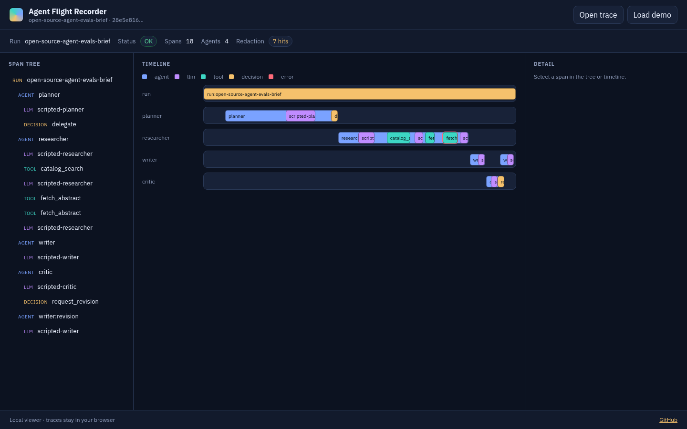
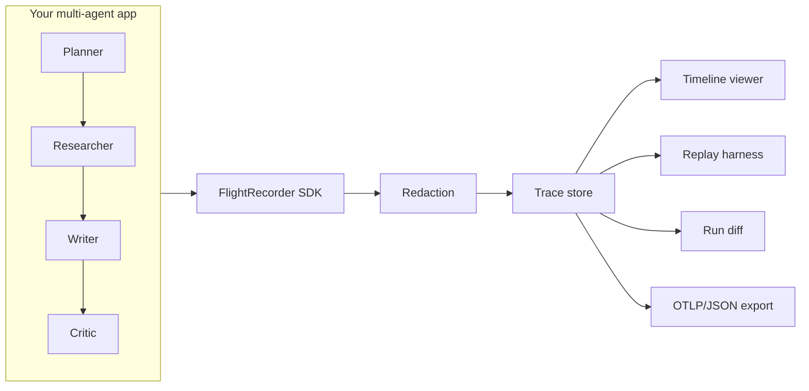

# Agent Flight Recorder

A **flight recorder** for multi-agent systems: record every message, tool call, model call, and decision in a run, **redact secrets and PII before storage**, **replay** a run from any step, and **diff** two runs to see where they diverged.

Built by [Kevin Fairley](https://github.com/kfairy9999) (Provefirst, Los Angeles) as part of a public body of work on **autonomous multi-agent orchestration**. This repository is the audit and replay piece of that stack.

[](https://github.com/kfairy9999/agent-flight-recorder/actions/workflows/ci.yml)
[](LICENSE)

**Live viewer demo:** [kfairy9999.github.io/agent-flight-recorder](https://kfairy9999.github.io/agent-flight-recorder/)

> This is a v0.1 library and CLI, not a hosted observability product. It does not claim OpenTelemetry certification, regulatory compliance, or that redaction is complete. See [Limitations](#limitations) and [SECURITY.md](SECURITY.md).



## Why this exists

When a team of agents fails, the useful question is rarely "what did the last model say?" It is "which handoff, tool result, or decision sent the run off the rails — and can I replay from there?"

Most traces today are either unstructured chat logs or generic request spans. Agent Flight Recorder stores a structured, OpenTelemetry-compatible trace of a _multi-agent_ run, with parent/child spans and causal links between agents, so you can inspect, replay, and compare.

## Architecture



A run is a single trace. Each agent, LLM call, tool call, and decision is a span. Messages are span events. Handoffs are [span links](https://opentelemetry.io/docs/concepts/signals/traces/#span-links) with an `afr.link.type` (`handoff`, `uses_result`, `caused_by`, or `follows`).

The on-disk format and the mapping to OTLP are described in [DESIGN.md](DESIGN.md).

## Quickstart

Requires Node.js 22 or later. The package is not published to npm; clone it and use it from source.

```bash
git clone https://github.com/kfairy9999/agent-flight-recorder.git
cd agent-flight-recorder
npm install
npm test
npm run demo          # writes examples/traces/research-desk.afr.json
npx tsx src/cli.ts view examples/traces/research-desk.afr.json
```

Instrument a run:

```ts
import { FlightRecorder, MemoryTraceStore } from './src/index.js';

const recorder = new FlightRecorder({
  serviceName: 'research-desk',
  store: new MemoryTraceStore(),
});

const run = recorder.startRun('weekly-brief');
const researcher = run.startAgent({ id: 'researcher', role: 'researcher' });
researcher.addMessage({ role: 'user', content: 'Summarize recent eval papers.' });

const search = researcher.startToolCall({
  name: 'search',
  arguments: { q: 'LLM evaluation benchmarks 2026' },
});
search.end({ result: { hits: 3 } });

const llm = researcher.startLlmCall({
  model: 'scripted-demo',
  provider: 'demo',
  temperature: 0,
});
llm.end({ output: 'Three relevant papers…', finishReason: 'stop' });

researcher.recordDecision({ type: 'handoff', summary: 'Pass notes to the writer.' });
const writer = run.startAgent({ id: 'writer', role: 'writer' });
run.linkTo(writer, researcher, 'uses_result');

researcher.end();
writer.end();
run.end();

const trace = await recorder.flush(run); // redacted, then persisted
```

`flush()` redacts the trace **before** it is written to the store. The in-memory recorder then drops the raw spans.

### Replay and diff

```ts
import { replayFrom, diffRuns } from './src/index.js';

const harness = replayFrom(trace);
const ctx = harness.context();

// Deterministic: recorded tool and model outputs are returned as stubs.
await ctx.complete({ model: 'scripted-demo', messages: [] });
await ctx.callTool('search', { q: 'LLM evaluation benchmarks 2026' });

// Hybrid: keep stubs until fromStep, then call a live model to compare.
const hybrid = replayFrom(trace, {
  mode: 'hybrid',
  fromStep: 4,
  liveModel: async (request) => myModel(request),
});

const resimulated = await harness.resimulate();
const diff = diffRuns(trace, resimulated);
if (!diff.equal) {
  console.log(diff.firstDivergence);
}
```

Replay stubs the **recorded** tool and model outputs. Your application still has to drive the same control flow (or use `resimulate()` to walk the recorded span sequence). If the code takes a different path, the harness raises `ReplayDivergenceError`.

### CLI

```bash
npx tsx src/cli.ts inspect path/to/run.afr.json
npx tsx src/cli.ts view path/to/run.afr.json --port 4173
npx tsx src/cli.ts html path/to/run.afr.json -o /tmp/run.html
npx tsx src/cli.ts redact path/to/run.afr.json --in-place
npx tsx src/cli.ts diff run-a.afr.json run-b.afr.json
npx tsx src/cli.ts replay path/to/run.afr.json --from-step 3 -o /tmp/replay.afr.json
npx tsx src/cli.ts export-otlp path/to/run.afr.json -o /tmp/run.otlp.json
```

`diff` exits `2` when the runs are not equivalent (ignoring IDs and timestamps).

### Adapters

- `runToolLoop` — a plain tool-calling loop (ReAct-style) that records every model turn and tool result.
- `instrumentMcpTools` — wrap MCP-shaped `{ name, arguments }` tools so each call becomes a child span. This is an in-process adapter, not a network MCP server.

A complete four-agent demo (planner, researcher, writer, critic), including a failed tool fetch and a requested revision, lives in [`examples/research-desk.ts`](examples/research-desk.ts). The recorded trace is checked in at [`examples/traces/research-desk.afr.json`](examples/traces/research-desk.afr.json).

## What's in a trace

| Span type (`afr.span.type`) | What it captures                                     |
| --------------------------- | ---------------------------------------------------- |
| `run`                       | The root span for one orchestration                  |
| `agent`                     | One agent's work, with message events                |
| `llm`                       | Model, parameters, output, token usage (`gen_ai.*`)  |
| `tool`                      | Tool name, arguments, result or error                |
| `decision`                  | An explicit choice (delegate, retry, accept, revise) |

Every span gets a monotonic `afr.step.index` so replay can start at a specific step. See [DESIGN.md](DESIGN.md) for the schema and the OTLP mapping.

## Limitations

- **Redaction is best-effort pattern matching**, not a guarantee. Encoded, truncated, or novel secrets can slip through. It is not a compliance certification. Details and the threat model are in [SECURITY.md](SECURITY.md).
- **Replay is not a time machine for arbitrary programs.** It stubs recorded tool and model I/O. Hidden state that never went through the recorder will not come back.
- **OTel-compatible is not "an official OpenTelemetry SDK."** The on-disk format uses OTel IDs, Unix-nano timestamps, attribute types, and an OTLP/JSON exporter. It does not implement the full OpenTelemetry API or protocol surface.
- **v0.1 is local-first.** The store is a JSON file or an in-memory map. There is no hosted backend, auth, or multi-tenant isolation.
- **The demo model is scripted.** The example and tests do not call a paid API.

## Development

```bash
npm run lint
npm run typecheck
npm test
npm run test:coverage
npm run build
```

CI runs lint, format, typecheck, tests, coverage thresholds, and a CLI smoke check on Node 22 and 24.

## License

MIT © 2026 Kevin Fairley
